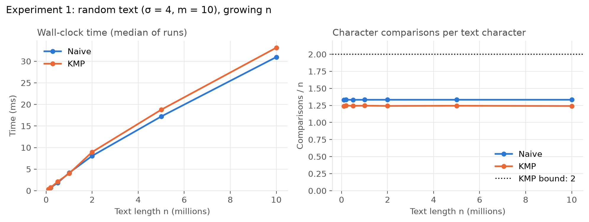
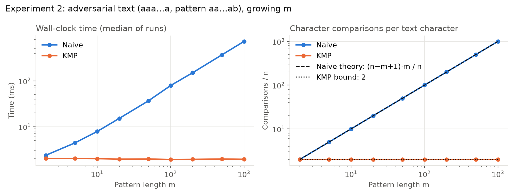
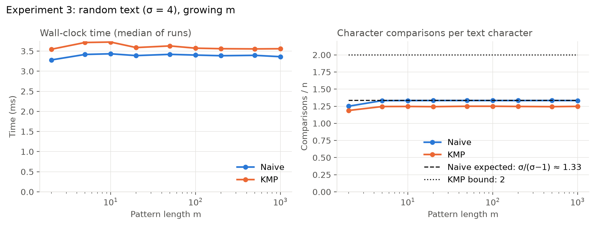
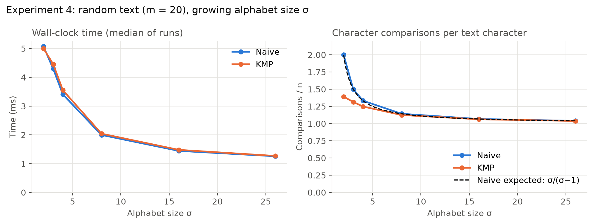
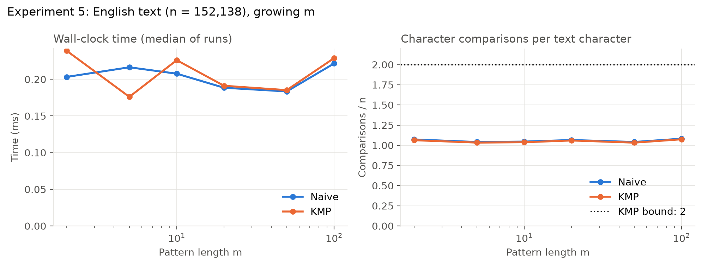
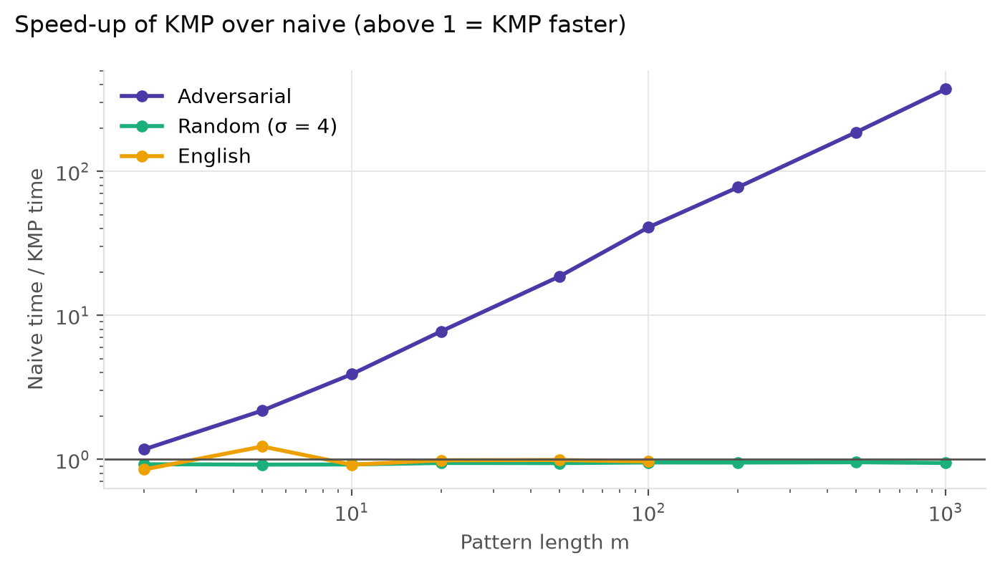
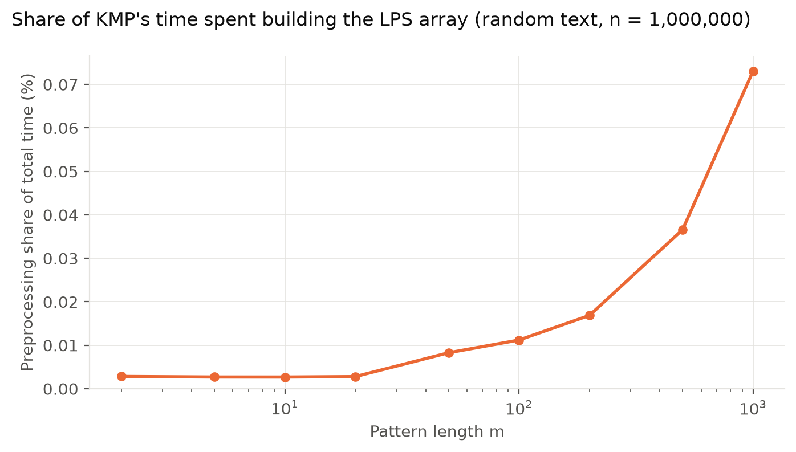

# KMP vs Naive: Empirical Study Report

**Le Hoa Long Nguyen, 26117008, 41052** · Assignment 1, Track A

<!--
HOW TO USE THIS TEMPLATE (delete this comment block before submitting)
- **[FILL IN: …]** marks something only you can write. Replace the whole marker.
- *Guidance* lines in italics say what a section should contain. Delete them before you submit.
- Numbers marked **[UPDATE]** come from your earlier run. Check them against plots/summary.csv from your latest run.
- Figures are linked from the plots/ folder, so they display on GitHub automatically once plots/ is committed.
- Keep sections (c) and (d) in your own voice.
-->

## (a) What I built

_Guidance: orient the reader before they open the repository. Around half a page. Don't repeat the README's build steps._

I implemented the Knuth–Morris–Pratt (KMP) string-matching algorithm in C++17 and compared it empirically against the naive (brute-force) algorithm. I chose to do this algorithm as i was particularly interested in a string-matching algorithm and i thought it was be easier to understand as opposed to some of the other options.

**The algorithm.** KMP runs in two phases. It first builds the LPS array (longest proper prefix that is also a suffix) for the pattern in O(m). It then scans the text once in O(n), using the LPS array to decide how far to fall back after a mismatch, so it never re-reads a text character. For each position i, lps[i] stores the length of the biggest prefix of the pattern that is also the suffix up to i. For `aabaaab` the array is 0, 1, 0, 1, 2, 2, 3; for example, lps[6] = 3 because the whole pattern both starts and ends with aab. During the search, when a mismatch happens after j characters have matched, only j falls back, to lps[j − 1], while i keeps moving forward and never backtracks. This means KMP keeps the part of the match that could still start a new match, instead of re-reading text it has already seen.

**Key design decisions**

| Decision            | Choice                                                | Reason                                                                                            |
| ------------------- | ----------------------------------------------------- | ------------------------------------------------------------------------------------------------- |
| Language            | C++17, MSVC, Release x64 (/O2)                        | Compiled code, so timings reflect the algorithms rather than interpreter overhead                 |
| Output              | Count of all matches, including overlapping ones      | Every run scans the whole text, so timings aren't affected by where the first match happens to be |
| Structure           | `buildLPSArray` and `kmpSearch` as separate functions | Preprocessing can be timed and counted separately from searching                                  |
| Comparison counting | Separate instrumented copies (`CountedSearch`)        | A counter inside the timed functions would slow them down and distort timings                     |
| Empty pattern       | Returns 0                                             | Avoids `lps[j - 1]` reading out of bounds                                                         |

**Simplifications**

My implementation follows the standard LPS version of KMP rather than the optimised table in the original paper. It returns the number of matches instead of their positions, so that timings measure searching rather than storing results. As an extension for this study, I also wrote instrumented copies of both algorithms that count character comparisons, with preprocessing and search counted separately. Empty pattern returns 0. Mathematically an empty pattern "matches" at every position; you chose 0 to avoid reading lps[-1].

**Code map**

| File                       | Contents                                                              |
| -------------------------- | --------------------------------------------------------------------- |
| `KMPAlgorithm.hpp/.cpp`    | `buildLPSArray` and `kmpSearch`                                       |
| `NaiveSearch.hpp/.cpp`     | `naiveSearch`, the baseline                                           |
| `CountedSearch.hpp/.cpp`   | Copies of both algorithms that count character comparisons            |
| `InputGenerators.hpp/.cpp` | Random, adversarial and file-based text generation                    |
| `main.cpp`                 | Correctness tests, then the five experiments; writes `results.csv`    |
| `plot_results.py`          | Reads `results.csv`; writes the figures and `summary.csv` to `plots/` |

## (b) Empirical study

### What I compared

I compared KMP against the naive algorithm, which checks every alignment of the pattern from left to right and stops at the first mismatch. Naive is the algorithm KMP was designed to improve on, so it gives the clearest test of whether KMP's better bound matters in practice.

Each algorithm was measured in two ways:

- **Character comparisons**, a machine-independent count that should match the theory exactly.
- **Wall-clock time**, which shows how the algorithm behaves on a real CPU and compiler.

Comparing the two measures is the core of the study: where they disagree, practice has diverged from theory.

### Theory and hypotheses

| Measure                      | Naive                                                               | KMP                                                        |
| ---------------------------- | ------------------------------------------------------------------- | ---------------------------------------------------------- |
| Worst case                   | O(nm): (n − m + 1) × m comparisons on text `aaa…a`, pattern `aa…ab` | O(n + m): at most 2n search + 2m preprocessing comparisons |
| Random text, alphabet size σ | About σ/(σ − 1) comparisons per text character                      | Between 1 and 2 per character                              |
| Preprocessing                | None                                                                | O(m) to build the LPS array                                |

_Guidance: write each hypothesis as a testable prediction, then say in the results whether it held._

- **H1 (scaling in n):** both algorithms' running times grow linearly with n.
- **H2 (worst case):** on the adversarial input, naive's time grows linearly with m while KMP's stays constant.
- **H3 (typical case):** on random text, naive's cost does not grow with m, because it fails after about σ/(σ − 1) comparisons per alignment.
- **H4 (alphabet size):** KMP's advantage in comparisons is largest for small σ and disappears as σ grows.
- **H5 (natural text):** English text behaves like a large alphabet, so naive matches or beats KMP.
- \*\*H6 Hypothesis: I believe that the KMP algorithm would outperform the brute force approach in all aspects.

### Method

**Correctness first.** Before any timing, the program checks that naive, KMP and both counted copies agree with a reference built on `std::string::find`. The tests cover 8 hand-picked edge cases, 4 hand-traced LPS arrays, and 10,000 random inputs over alphabets of size 1, 2, 3, 4 and 26. On every input they also check KMP's bounds: at most 2m preprocessing comparisons and 2n search comparisons. The benchmarks run only if every test passes.

**Experiments.** Each experiment changes one variable and holds the rest fixed.

| #   | Input                                      | Varied                    | Fixed                 |
| --- | ------------------------------------------ | ------------------------- | --------------------- |
| 1   | Random text, σ = 4                         | n = 100,000 to 10,000,000 | m = 10                |
| 2   | Adversarial: text `aaa…a`, pattern `aa…ab` | m = 2 to 1,000            | n = 1,000,000         |
| 3   | Random text, σ = 4                         | m = 2 to 1,000            | n = 1,000,000         |
| 4   | Random text                                | σ = 2 to 26               | n = 1,000,000, m = 20 |
| 5   | English text Alice in Borderland text      | m = 2 to 100              | the book              |

**Data generation.**

- Random text draws each character uniformly from the first σ letters (`a`, `b`, …) using `std::mt19937`.
- Patterns for random and English text are copied from a random position in the text, so each has at least one match.
- The seed is fixed at 42, so every run generates identical inputs.
- Each random setting is tested with 5 different patterns, to avoid conclusions based on one unusual pattern.

**Measurement.**

- Time: `std::chrono::steady_clock`, one warm-up run, then the median of 11 timed runs. Input generation happens outside the timed region.
- KMP's total time includes building the LPS array. The LPS construction is also timed on its own.
- A running checksum of results is printed at the end, so the compiler cannot remove searches whose result is unused.
- Comparisons: counted by the instrumented copies, run once per input, since counts are deterministic.
- Across the 5 patterns, times are summarised by the median and comparisons by the mean.

**Machine.**

| Component        | Value                                             |
| ---------------- | ------------------------------------------------- |
| CPU              | AMD Ryzen 7 4800H with Radeon Graphics            |
| RAM              | 16.0 GB DDR4                                      |
| Operating system | Windows 11                                        |
| Compiler         | MSVC 14.39 (Visual Studio 2022), Release x64, /O2 |

### Results

In running time, naive was faster than KMP on every realistic input, by about 1–10%, even though it made more character comparisons. KMP was faster only on the adversarial input, from m = 5 upwards and by up to 362×, and marginally on binary text (σ = 2). In comparisons, KMP never did more work than naive. **[UPDATE: add the English result once confirmed.]**

_Guidance: for each experiment, give 1–2 key numbers under the figure and say whether the hypothesis held. Save the "why" for the Analysis section._

#### Experiment 1: growing text length (H1)

| n          | Naive   | KMP     |
| ---------- | ------- | ------- |
| 1,000,000  | 3.42 ms | 3.69 ms |
| 10,000,000 | 30.3 ms | 32.9 ms |

H1 held: 10× more text took about 9× longer for both. Naive was about 8% faster at every size. **[UPDATE]**

#### Experiment 2: adversarial input (H2)

| m     | Naive   | KMP     | Naive comparisons | KMP comparisons |
| ----- | ------- | ------- | ----------------- | --------------- |
| 2     | 1.80 ms | 1.98 ms | 1,999,998         | 1,999,999       |
| 10    | 7.85 ms | 1.95 ms | 9,999,910         | 1,999,991       |
| 100   | 78.0 ms | 1.93 ms | 99,990,100        | 1,999,901       |
| 1,000 | 722 ms  | 2.00 ms | 999,001,000       | 1,999,001       |

H2 held. Naive's comparisons equal (n − m + 1) × m exactly, and KMP stays just under 2n for every m. The exception is m = 2, where both did 2n comparisons and naive was about 10% faster. **[UPDATE]**

#### Experiment 3: random text, growing pattern length (H3)

H3 held. Naive stayed at about 3.4 ms and 1.333 comparisons per character for every m from 5 to 1,000, matching σ/(σ − 1) = 4/3. KMP made fewer comparisons (about 1.25 per character) but took about 3.55 ms, around 5% slower. At m = 2 naive made 1.25 comparisons per character, which matches the exact expectation 1 + 1/σ for a 2-character pattern. **[UPDATE]**

#### Experiment 4: alphabet size (H4)

| σ   | Naive comparisons/char | KMP comparisons/char | Faster          |
| --- | ---------------------- | -------------------- | --------------- |
| 2   | 2.00                   | 1.39                 | KMP, about 3%   |
| 4   | 1.33                   | 1.25                 | Naive, about 5% |
| 8   | 1.14                   | 1.13                 | Naive, about 3% |
| 26  | 1.04                   | 1.04                 | Tie (within 1%) |

H4 held. Naive's comparisons follow σ/(σ − 1) at every σ, and the gap between the algorithms closes as σ grows. KMP's win at σ = 2 was narrow: faster in 4 of the 5 patterns. **[UPDATE]**

#### Experiment 5: English text (H5)

**[FILL IN: the median times and comparisons per character for a few values of m, from summary.csv. Did H5 hold?]**

#### Summary across experiments

Building the LPS array took under 0.07% of KMP's total time even at m = 1,000, with n = 1,000,000. **[UPDATE]**

### Analysis: why the results came out this way

_Guidance: this is where most of the marks are. Answer each question below in your own words, using your numbers as evidence. One or two paragraphs each. Delete the questions once you've answered them._

**Where theory and practice agree.** Comparison counts matched the formulas almost exactly in every experiment.

**[FILL IN: why do comparison counts match theory so closely, while times don't? What does a comparison count ignore about how a program actually runs?]**

**Divergence 1: KMP does less work but runs slower on typical text.** On random text with σ = 4, KMP made about 6% fewer comparisons than naive but took about 5% longer.

**[FILL IN: explain why.]** Questions to work through:

1. In naive's inner loop, what happens at each step? How many branches are there, and how predictable are they on random text?
2. In KMP's loop, which of the three cases runs next depends on the data. How predictable is that for the CPU?
3. On a mismatch with j > 0, KMP reads `lps[j - 1]` and loops again without moving `i`. What does that cost that naive doesn't pay?
4. Search terms: "branch misprediction", "instruction-level parallelism".

**Divergence 2: when does saving comparisons pay off?** KMP won at σ = 2, lost at σ = 4, and won by 362× on the adversarial input.

**[FILL IN: explain the pattern. Compare how many comparisons KMP saves in each case with the extra cost per step from Divergence 1. Why is the adversarial case so extreme?]**

**Divergence 3: equal work, different speed.** At m = 2 on the adversarial input, both algorithms made 2n comparisons, but naive was about 10% faster.

**[FILL IN: what does this case show on its own, with the work held equal?]**

**Compiler effect.** A preliminary run of the same code with g++ on Linux showed naive about 20% faster than KMP on random text. With MSVC it was about 5–8%.

**[FILL IN: what does it mean that the gap depends on the compiler? Keep this short; your main results are from MSVC. Note that the g++ run was done by the AI, not on your machine: mention that in section (d), or cut this paragraph.]**

**Conclusion.** **[FILL IN: 3–4 sentences. Which algorithm would you use in practice, and when? What is KMP's real advantage, if not speed on typical text?]**

### Limitations

_Guidance: keep each to one or two sentences, and say how it could be fixed._

- **Timer resolution.** The Windows clock ticks every 100 ns, and building the LPS array for short patterns takes less than one tick. Preprocessing times for small m are only upper bounds. Timing many LPS constructions in a loop and dividing would fix this.
- **One machine, one compiler.** All final results come from one CPU with MSVC. The g++ comparison suggests the size of the naive–KMP gap is compiler-dependent.
- **Timing noise.** Some individual measurements vary between patterns and runs. The median of 11 runs and 5 patterns reduces this but doesn't remove it. Differences of 1–2% should be treated as ties.
- **Input range.** Random text is uniformly distributed, which real data rarely is. Only one English text was tested.
- **Baseline choice.** Only naive was compared. A practical baseline such as Boyer–Moore–Horspool or `std::string::find` might change the conclusions.
- **[FILL IN: anything else you noticed, or delete this line.]**

## (c) What I learned

_Guidance: the spec asks for specific examples over general statements. Each answer should name a concrete moment, number or line of code. Write these entirely in your own words, and use the prompts only if they were true for you._

**What surprised me.** 
What surprised me the most was that while the KMP algorithm was consistently doing fewer character comparisons than the naive approach on all tests that were performed, it still ran slower than the naive approach on most cases other than the worst case scenarios such as `aaaa....aa` or `aaaaaab`. I believe this was due to the KMP algorithm having to create an LPS array of size m before it started the comparisons whilst the naive approach started straight away.

**What I initially got wrong.** **[FILL IN]**
There were a few logic errors when i was first typing up the KMP algorithm, one that really stuck with me was when i was comparing `text[i]` with `pattern[i]` instead of `pattern[j]` which resulted in a string subcript out of range crash. Luckily the use of ai was approved for this assignment and it could detect my mistake instantly.

Possible starting points:

- Comparing `text[i]` with `pattern[i]` instead of `pattern[j]` in the search, which caused the "string subscript out of range" crash.
- Writing `else (j == 0); { i++; }`, where the semicolon ended the `else`, so `i++` ran on every iteration.
- Returning `-1` from a function declared to return `std::vector<int>`.

**Something I understand now that I didn't before.** **[FILL IN]**

Possible starting points:

- Why the LPS fallback `len = lps[len - 1]` works, and why `i` doesn't move on a fallback.
- The difference between a worst-case bound and typical-case behaviour.
- Why timing measurements need a Release build, repeated runs and a median.

## (d) AI use

_Guidance: check the AI Use Policy at the end of the assignment spec for any required format, and adjust this section to match. Edit anything you remember differently, and add anything that happened outside these sessions._

I used Claude (Anthropic) throughout this project as a tutor and as a code generator for the benchmarking infrastructure.

| Part                                                                                                 | Who wrote it                | How AI was involved                                                                                                                                                             |
| ---------------------------------------------------------------------------------------------------- | --------------------------- | ------------------------------------------------------------------------------------------------------------------------------------------------------------------------------- |
| Choosing the baseline and experiment design                                                          | Me with AI assistance    | I decided to compare against naive as the baseline whilst Claude proposed the input families and the two measures (comparisons, time)                                                                 |
| Visual Studio setup and file structure                                                               | Me                          |  N/A                                                                                             |
| `buildLPSArray`                                                                                      | Me with AI assistance | Claude provided help to turn the theory into working code and created an interactive trace; I tested it on hand-traced patterns                                                          |
| `kmpSearch`                                                                                          | Me                          | Claude explained the approach and gave a trace. I wrote the code; Claude found two bugs in my first version (`pattern[i]` for `pattern[j]`, and the `else (j == 0);` semicolon) |
| `naiveSearch`                                                                                        | Claude                      | Written at my request, with a line-by-line explanation                                                                                                                          |
| Benchmark harness, counted copies, input generators (`main.cpp`, `CountedSearch`, `InputGenerators`) | Claude                      | Written by Claude and explained to me; I ran them on my machine                                                                                                                 |
| `plot_results.py`                                                                                    | Claude                      | Written by Claude                                                                                                                                                               |
| Verification                                                                                         | Claude                      | Claude tested my code against a brute-force reference on 100,000 random inputs                                                                                                  |
| Interpreting results                                                                                 | Me, with AI help            | Claude explained what the CSV contained and summarised the findings; the analysis in section (b) is my own                                                                      |
| This report                                                                                          | Me                          | Claude produced this template with my measured numbers filled in. The analysis, section (c) and the final wording are mine                                                      |

**[FILL IN: 2–3 sentences reflecting on the AI use. What did it help you understand? Where did you check or push back on what it gave you? What would you do differently?]**

## References

1. Knuth, D. E., Morris, J. H., and Pratt, V. R. (1977). Fast pattern matching in strings. _SIAM Journal on Computing_, 6(2), 323–350.
2. Abdul Bari, 9.1 Knuth-Morris-Pratt KMP String Matching Algorithm , online video, YouTube, viewed 25 September 2026, https://www.youtube.com/watch?v=V5-7GzOfADQ
3. ByteQuest, Knuth-Morris-Pratt Algorithm , online video, YouTube, viewed 25 septhember 2026, https://www.youtube.com/watch?v=q4_90fOoS-s

## Appendix: reproducing the results

1. Open the solution in Visual Studio 2022 and select **Release** and **x64**.
2. Put the English text at `data/english.txt` in the project folder.
3. Run with Ctrl+F5. The program runs the correctness tests, then all five experiments, and writes `results.csv`.
4. Run `python plot_results.py` (requires pandas and matplotlib) to produce the figures and `summary.csv` in `plots/`.

The random seed is fixed, so the inputs are identical on every run. Times will differ on other machines.
